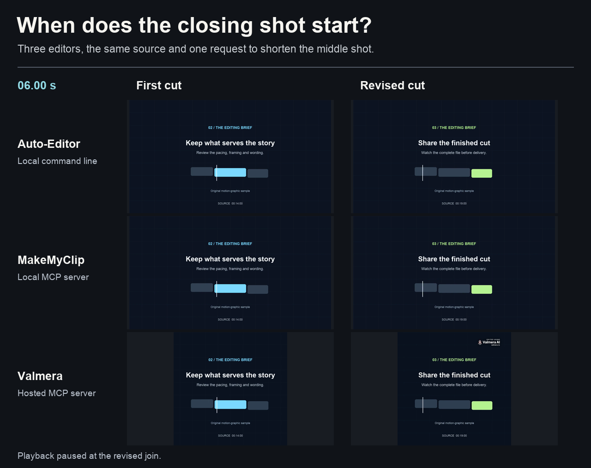

# Did the next shot move when the middle shot got shorter?

The first edit keeps source seconds 3–7, 12–16 and 19–23. The revision shortens the middle selection to 12–14. In the revised cut, the closing shot should start at output second 6 and show source second 19. Valmera ran this check on November 16, 2026 using its own 25-second silent clock clip.

## Watch the closing shot move in three editors

At output second six, read the large title in each column. The first cuts still show “Keep what serves the story.” All three revisions already show “Share the finished cut.” At second eight the first cuts catch up to the same shot, two seconds behind the revisions.

[](https://raw.githubusercontent.com/ABO3SKRALMASAOODI/awesome-ai-video-editing/main/examples/rough-cut-revision/watch-the-revision.mp4)

[Play or download the synchronized comparison (MP4, 165 KiB)](https://raw.githubusercontent.com/ABO3SKRALMASAOODI/awesome-ai-video-editing/main/examples/rough-cut-revision/watch-the-revision.mp4). The display pauses at the join so you can inspect it. Each file keeps its exported aspect ratio. The Valmera brief specified a square center crop.

## Get the files

1. [Download and extract the source and four hosted/local MCP exports](https://raw.githubusercontent.com/ABO3SKRALMASAOODI/valmera-mcp/ed1374e07ba63652f8461280cf69ca19c67f2ee8/docs/examples/video-edit-revision/revision-test.zip). The archive contains the initial and revised files from Valmera and MakeMyClip.
2. Save [Auto-Editor’s first cut](cli-first.mp4), [its revised cut](cli-revised.mp4) and the [frame check](inspect_join.py) in the extracted folder.
3. With Python 3, Pillow and FFmpeg installed, run the following command there.

```sh
python3 inspect_join.py original-source.mp4 first-preview.mp4 revised-final.mp4 first-cut.mp4 shorter-cut.mp4 cli-first.mp4 cli-revised.mp4
```

The check compares each selected output frame with every frame of the source, returns the closest match and reports ties. It uses a centered 96 × 96 grayscale crop to compare different canvas shapes. Mean absolute pixel difference is on a 0–255 scale. The synthetic clock makes these three moments visually distinct. For footage with static holds, repeated frames can produce equally good matches. To inspect the result by eye, step across output frames 179 and 180 and read the clock in the picture.

| File pair | Frame 179, before the join | Frame 180, at the join | Frame 240, two seconds later |
| --- | --- | --- | --- |
| Valmera first / revised | 419 / 419 | 420 / 570 | 570 / 630 |
| MakeMyClip first / revised | 419 / 419 | 420 / 570 | 570 / 630 |
| Auto-Editor first / revised | 419 / 419 | 420 / 570 | 570 / 630 |

Each cell gives the source-frame number for the first cut and the revised cut. All 18 matches were unique within this source. This exercise checks shot timing. The input has no speech and the editor receives the selection boundaries.

## Render the command-line cuts yourself

Install [Auto-Editor 31.9.0](https://github.com/WyattBlue/auto-editor/releases/tag/31.9.0). From the folder with the source clip, run these commands. The revision moves the start of one removed interval from 16 s to 14 s. Both commands use the original file as input.

```sh
auto-editor original-source.mp4 --edit none --cut 0sec,3sec --cut 7sec,12sec --cut 16sec,19sec --cut 23sec,end --no-open -o cli-first.mp4
auto-editor original-source.mp4 --edit none --cut 0sec,3sec --cut 7sec,12sec --cut 14sec,19sec --cut 23sec,end --no-open -o cli-revised.mp4
```

Auto-Editor kept the original 1280 × 720 landscape frame. The MCP tools used different canvases. The [local timeline calls and hosted editing record](https://github.com/ABO3SKRALMASAOODI/valmera-mcp/blob/ed1374e07ba63652f8461280cf69ca19c67f2ee8/docs/examples/video-edit-revision/makemyclip/README.md) explain how those files were made.

## Did any of the other frames change position?

Each export contains a running clock printed in the source picture. We compared that clock against all 750 original frames for every frame of the 12-second first cut and the 10-second revised program. That covers 1,980 output frames across the six files. An extra ending after the program is counted separately.

| Editor | First cut matching its source clock | Revision matching its source clock | Extra frames after revised program |
| --- | ---: | ---: | ---: |
| Auto-Editor | 360/360 | 300/300 | 0 |
| MakeMyClip | 360/360 | 300/300 | 0 |
| Valmera | 360/360 | 300/300 | 150 (5 s) |

The last four program frames in Valmera’s delivery illustrate a trap. A direct grayscale comparison picked the wrong source time for all four as the branded ending faded in. Matching the shape of the clock digits after adjusting for brightness identified the expected frame in each case. The source shot remained in sequence while its appearance changed. If your delivery has an exact runtime, check the end of the downloaded file too.

To reproduce, save [the clock checker](check_full_program.py) next to the media from the steps above. Install NumPy and put FFmpeg on your path. Run it on any of the three file pairs, for example:

```sh
python3 check_full_program.py original-source.mp4 first-preview.mp4 revised-final.mp4
```

The checker square-crops both inputs around their centers, scales to 720 × 720 and reads the same 168 × 32 pixel area around the source clock. It reports the nearest source picture by absolute grayscale error and by normalized correlation. It records ties separately. This measurement applies to the supplied 30 fps clock clip. It measures picture timing. Sound, caption positioning and editorial judgment each need their own test. [Full results for all six files](program-frame-results.json).
